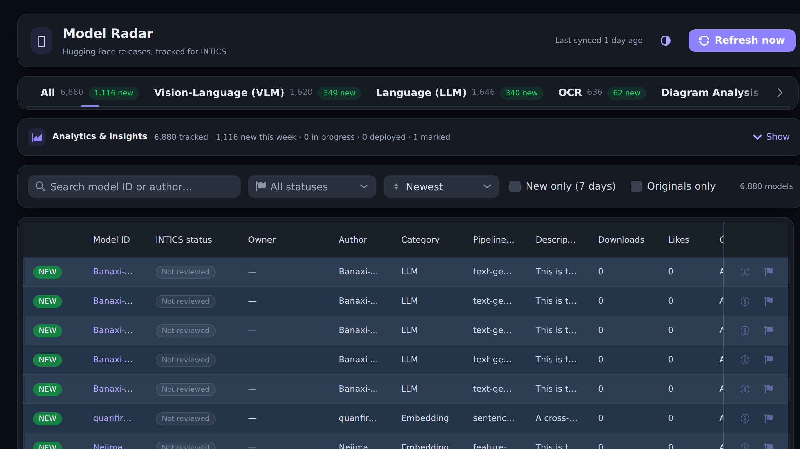
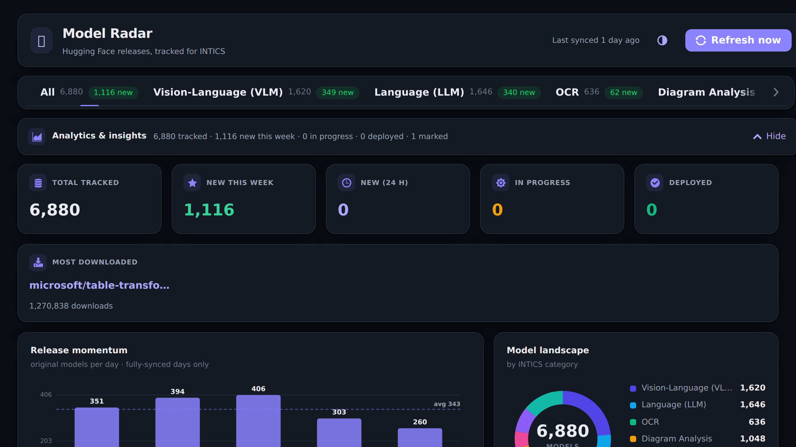
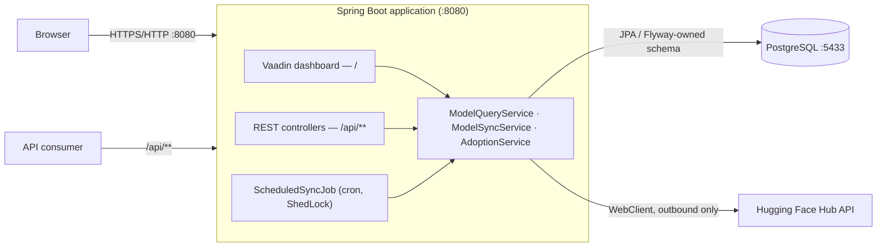
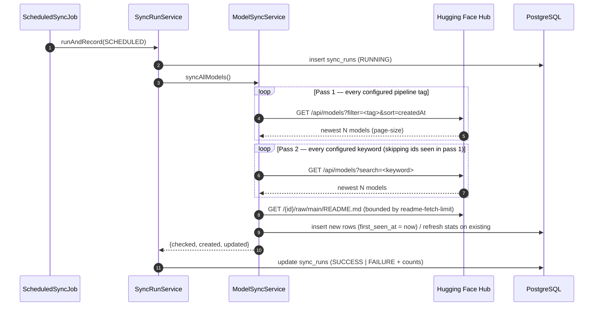
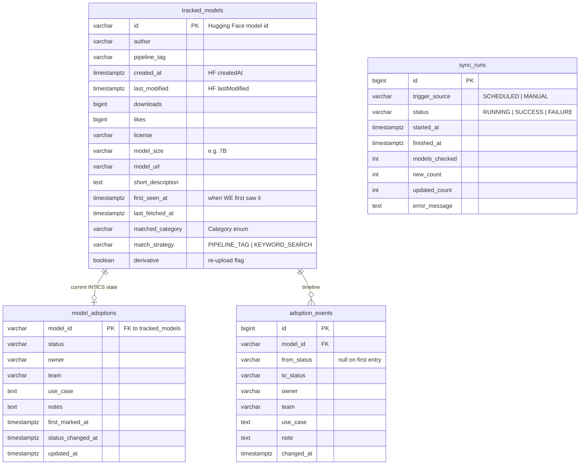

<div align="center">

# INTICS Model Radar

**Continuous discovery of Hugging Face models relevant to INTICS — and a record of what we do with them.**

[](https://openjdk.org/projects/jdk/21/)
[](https://spring.io/projects/spring-boot)
[-00B4F0?logo=vaadin&logoColor=white)](https://vaadin.com)
[](https://www.postgresql.org/)
[](#building)
[](#project-status)

</div>

---

## Table of contents

1. [Overview](#overview)
2. [Screenshots](#screenshots)
3. [Feature summary](#feature-summary)
4. [Architecture](#architecture)
5. [Technology stack](#technology-stack)
6. [Quick start](#quick-start)
7. [Using the dashboard](#using-the-dashboard)
8. [Adoption tracking](#adoption-tracking)
9. [REST API reference](#rest-api-reference)
10. [Configuration reference](#configuration-reference)
11. [Data model](#data-model)
12. [Analytics methodology](#analytics-methodology)
13. [Operations](#operations)
14. [Deployment](#deployment)
15. [Security considerations](#security-considerations)
16. [Testing and quality](#testing-and-quality)
17. [Project structure](#project-structure)
18. [Troubleshooting](#troubleshooting)
19. [Known limitations and roadmap](#known-limitations-and-roadmap)
20. [Contributing](#contributing)
21. [Documentation map](#documentation-map)
22. [Project status](#project-status)

---

## Overview

New models appear on [Hugging Face](https://huggingface.co) faster than any team can
follow by hand, and only a narrow slice of them matters to a document-intelligence
product. **Model Radar** closes that gap: it queries the Hugging Face Hub on a
schedule, keeps every model that matches INTICS's areas of interest, records when
**we** first saw it, and presents the result as a single dashboard.

The intended experience is simple — open one screen and see, in under a minute, what
is new and worth a closer look. Model Radar also records the other half of the
picture: which models INTICS is **evaluating, integrating, or running in
production**, who owns each one, and how that changed over time.

**What it tracks.** Seven INTICS-relevant categories (plus a fallback bucket), each
populated from official Hugging Face pipeline tags and from free-text keyword
searches:

| Category | Label in the UI | Typical contents |
| --- | --- | --- |
| `VLM` | Vision-Language (VLM) | Image-text-to-text, visual question answering |
| `LLM` | Language (LLM) | Text generation, text2text, extractive QA |
| `OCR` | OCR | Image-to-text, handwriting, receipt reading |
| `DIAGRAM_ANALYSIS` | Diagram Analysis | Object/keypoint detection, charts, P&ID, grounding |
| `DOCUMENT_QA` | Document Q&A | Document question answering, forms, invoices |
| `LAYOUT` | Layout & Table Structure | Segmentation, table structure and extraction |
| `EMBEDDING` | Embeddings & Retrieval | Feature extraction, sentence similarity, visual document retrieval |
| `OTHER` | Other | Fallback bucket |

**Design principles.**

- **One process, one deployment.** The API and the dashboard are the same Spring Boot
  application — there is no separate frontend server to build, run, or version.
- **The dashboard never calls Hugging Face.** All reads are served from PostgreSQL,
  so the UI is fast and stays available even when the Hub is slow or unreachable.
- **Non-developers control what is tracked.** Pipeline tags, keywords and re-upload
  rules live in `application.yml`, not in Java.
- **Every number is defensible.** Where our sampling cannot support a figure, the
  dashboard omits it and says so rather than drawing a misleading line
  (see [Analytics methodology](#analytics-methodology)).

---

## Screenshots

**Model list** — category tabs, filters, and the tracked-model grid with the `NEW`
badge and INTICS status pills.



**Analytics & insights** — collapsed by default; expands to KPI tiles, release
momentum, category landscape, licences, and top organisations.



---

## Feature summary

| Area | Capability |
| --- | --- |
| **Discovery** | Scheduled Hugging Face sync across configured pipeline tags (Strategy A) and keyword searches (Strategy B), newest-first, de-duplicated in one pass |
| **Freshness** | `first_seen_at` is recorded by us, driving a `NEW` badge and a configurable "new" window (default 7 days) |
| **Enrichment** | Licence and parameter-size extraction, plus per-model README fetching to populate a short description |
| **Noise control** | Automatic re-upload detection (quantizations, format conversions, mirror accounts) with an **Originals only** filter |
| **Browsing** | Category tabs with live counts, full-text search on model ID/author, status filter, sort by newest/downloads/likes, resizable and reorderable columns, shareable URLs for every view |
| **Detail** | Per-model panel with all stored Hugging Face fields, INTICS state, and a dated timeline |
| **Adoption tracking** | Status workflow (Evaluating → In progress → Deployed, plus On hold / Rejected), owner, team, use case, notes, and an append-only audit timeline |
| **Analytics** | KPI tiles, release momentum, category donut, new-this-week by category, licence mix, top organisations — all rendered server-side as SVG with no charting dependency |
| **Operations** | `sync_runs` audit trail, `/api/health` endpoint with a 26-hour freshness rule, ShedLock-guarded scheduling, manual sync from UI or API |
| **Integration** | Documented REST API over the same data the dashboard uses |
| **Presentation** | Dark theme by default with a light toggle, persisted per browser |

---

## Architecture

Model Radar is a **single Spring Boot application** that serves the REST API and the
Vaadin dashboard on one port (`8080`). A scheduled job inside the same process
fetches from Hugging Face and writes to PostgreSQL; all reads come from PostgreSQL.



**Request paths.** The dashboard calls Spring `@Service` beans **directly in the
JVM** — it does not go through the REST API. The REST API exists for external
consumers, automation, and debugging, and is served by the same beans, so both views
of the data are always consistent.

**Sync pipeline.** One run proceeds in two passes and touches each model once:



Existing rows are refreshed **only** in `downloads`, `likes`, `last_modified`,
`last_fetched_at` and the derivative flag. `first_seen_at`, the matched category and
the match strategy are never overwritten, so the "new to us" signal and the original
classification remain stable for the life of the row.

**Failure behaviour.** A Hub rate-limit (HTTP 429) is retried once after a backoff;
if it still fails, that tag or keyword is skipped, a warning is logged, and the run
continues — the next run picks it up. A failed run is still written to `sync_runs`
with status `FAILURE` and the error message, and the sync itself remains
transactional.

---

## Technology stack

| Layer | Technology | Notes |
| --- | --- | --- |
| Language / runtime | Java 21 | Records, sealed-friendly domain, virtual-thread ready |
| Application framework | Spring Boot 3.5.16 | Servlet stack (Tomcat) |
| UI | Vaadin 24.10.8 (`vaadin-core`) | Server-side Java UI embedded in the app; Apache-licensed components only, so no licence check at build or run time |
| Persistence | Spring Data JPA / Hibernate | `open-in-view: false`, `ddl-auto: validate` |
| Database | PostgreSQL 17 | Local instance via Docker Compose on host port `5433` |
| Schema management | Flyway | Migrations `V1`–`V5`; Flyway owns all DDL |
| Outbound HTTP | Spring `WebClient` (WebFlux) | Client only — the app itself stays servlet-based |
| Job locking | ShedLock 7.7.0 (JDBC) | Prevents overlapping syncs, including across instances |
| Charts | Hand-built SVG (`ui/Charts.java`) | No commercial or third-party charting dependency |
| Build | Maven Wrapper (`./mvnw`) | No system Maven required |

---

## Quick start

### Prerequisites

| Requirement | Version | Needed for |
| --- | --- | --- |
| JDK | 21 | Building and running the application |
| Docker + Compose | current | Local PostgreSQL (no native install required) |
| Node.js | 20+ | **Production builds only** (`-Pproduction` runs Vaadin's Vite build). Local development uses Vaadin's prebuilt dev bundle and needs no Node |
| Network access | — | Outbound HTTPS to `huggingface.co` |

### 1. Clone

```bash
git clone <repo-url> intics-model-radar
cd intics-model-radar
```

### 2. Start PostgreSQL

```bash
docker compose up -d     # postgres:17, published on localhost:5433
docker compose ps        # expect "healthy"
```

Database `model_radar`, user/password `modelradar` / `modelradar`, data persisted in
the named volume `model-radar-pgdata`.

> **Why host port 5433?** So the project never collides with a native PostgreSQL that
> may already own 5432 on a developer machine. Inside the container it is still 5432.

### 3. Run the application

```bash
cd backend
./mvnw spring-boot:run
```

Flyway applies migrations on startup, Hibernate validates the mapping against them,
and the app listens on **`http://localhost:8080`**. There is **no separate frontend
process** — the dashboard is part of this application.

### 4. Populate and verify

On a fresh database the dashboard is empty until the first sync. Trigger one (about a
minute, depending on the catalog size and README fetches):

```bash
curl -X POST http://localhost:8080/api/admin/sync
# {"checked":2515,"created":375,"updated":2140}

curl -s http://localhost:8080/api/health
# {"status":"UP","maxSyncAgeHours":26,"lastSuccessfulSyncAt":"...","lastSyncModelsChecked":2515,...}
```

Then open **<http://localhost:8080/>**.

### Building

```bash
cd backend
./mvnw test                          # unit tests (live HF integration test excluded by tag)
./mvnw test -DexcludedGroups=integration   # explicit CI form
./mvnw -Pproduction -DskipTests clean package
```

The production profile compiles an optimised frontend bundle into a self-contained
executable JAR (`backend/target/model-radar-0.0.1-SNAPSHOT.jar`, ~107 MB) that runs in
Vaadin **production mode** and requires **no Node.js at runtime**.

---

## Using the dashboard

The screen is ordered by what you came to do.

| # | Region | What it gives you |
| --- | --- | --- |
| 1 | **Header** | Last sync time, light/dark toggle, **Refresh now** |
| 2 | **Category tabs** | All + one tab per category, each with its total and a green "N new" badge |
| 3 | **Analytics & insights** | Collapsed by default; the bar still shows headline counts (tracked · new this week · in progress · deployed · marked). Expanding it reveals KPI tiles, charts and the recent-activity feed, and the choice is remembered per browser |
| 4 | **Filter bar** | Search by model ID or author, filter by INTICS status, sort, **New only (7 days)**, **Originals only**, **Clear filters**, and the live matching count |
| 5 | **Model list** | Fills the remaining height and scrolls on its own, so the page itself never scrolls. Columns are resizable and reorderable |

Each row carries two actions: **ℹ details** (or double-click the row) opens the full
panel — every Hugging Face field held for that model, plus INTICS state and timeline —
and **⚑** opens the status form.

**Every view is a URL.** Filters are mirrored into the address bar, so any view can be
bookmarked, shared, or linked from a ticket:

```text
http://localhost:8080/?category=OCR&status=in_progress&search=qwen&sort=downloads&new=true&originals=true
```

Non-Latin text in grid cells (CJK, Cyrillic, Arabic) is translated to English on hover
as a best-effort convenience and appended to the cell tooltip.

---

## Adoption tracking

Model Radar records not only what exists on Hugging Face but **what INTICS is doing
with it**. Use the **⚑** action on any row, or **Set INTICS status** in the detail
panel.

| Field | Notes |
| --- | --- |
| **Status** | Not reviewed → Evaluating → In progress → Deployed, plus On hold / Rejected |
| **Owner** | Person deploying or working with the model. Required. Suggests names already in use |
| **Team** | e.g. *ADI Platform*. Also suggests existing values |
| **Use case** | The INTICS product or project it serves |
| **Note** | What changed and why — lands on the timeline, dated |

Dates are never typed in. The application stamps *first marked*, *status changed* and
*last updated* itself, and every save appends an entry to that model's timeline
(from-status, to-status, owner, team, use case, note, timestamp), producing a complete
audit history at no extra effort. Returning a model to **Not reviewed** clears its
current state but **keeps the timeline**.

Marked models show a coloured status pill in the grid, are filterable from the status
dropdown, feed the *INTICS adoption* chart and the *Recent INTICS activity* feed, and
the **In progress** / **Deployed** KPI tiles double as one-click filters.

---

## REST API reference

Base URL `http://<host>:8080`. All responses are JSON (camelCase). Model IDs contain
slashes, so the endpoints that take an ID use wildcard path variables and accept the
ID verbatim (`/api/models/detail/Qwen/Qwen2.5-VL-7B-Instruct`).

### Models

| Method | Path | Description |
| --- | --- | --- |
| `GET` | `/api/models` | Paginated, filterable list of tracked models |
| `GET` | `/api/models/new` | Shorthand for the "new" window (default 7 days) |
| `GET` | `/api/models/detail/{id}` | One model plus its full adoption timeline; `404` if unknown |
| `GET` | `/api/categories` | Categories with per-category counts |

**`GET /api/models` parameters**

| Parameter | Type | Default | Description |
| --- | --- | --- | --- |
| `category` | enum name | — | `VLM`, `LLM`, `OCR`, `DIAGRAM_ANALYSIS`, `DOCUMENT_QA`, `LAYOUT`, `EMBEDDING`, `OTHER` |
| `newSince` | integer (days) | — | Only models first seen within the last N days |
| `sort` | `newest` \| `downloads` \| `likes` | `newest` | Unrecognised values fall back to `newest` |
| `search` | string | — | Matches model ID or author |
| `status` | `NOT_REVIEWED` \| `EVALUATING` \| `IN_PROGRESS` \| `DEPLOYED` \| `ON_HOLD` \| `REJECTED` | — | INTICS adoption status; `NOT_REVIEWED` selects models with no record |
| `originals` | boolean | `false` | `true` excludes detected re-uploads |
| `page` | integer | `0` | Zero-based |
| `size` | integer | `50` | Clamped server-side to 1–200 |

**Response envelope**

```jsonc
{
  "content": [ /* ModelResponse objects */ ],
  "totalElements": 6880,
  "page": 0,
  "size": 50
}
```

**`ModelResponse` fields** — `id`, `author`, `pipelineTag`, `matchedCategory`,
`matchedCategoryLabel`, `matchStrategy`, `createdAt`, `lastModified`, `downloads`,
`likes`, `license`, `modelSize`, `modelUrl`, `shortDescription`, `firstSeenAt`,
`isNew`, and the INTICS block: `inticsStatus`, `inticsStatusLabel`, `inticsOwner`,
`inticsTeam`, `inticsUseCase`, `inticsNotes`, `inticsFirstMarkedAt`,
`inticsStatusChangedAt`, `inticsUpdatedAt`. A model nobody has marked reports
`inticsStatus = "NOT_REVIEWED"` rather than `null`, so callers never special-case an
absent record. Internal bookkeeping (`lastFetchedAt`) is not exposed.

### Adoption

| Method | Path | Description |
| --- | --- | --- |
| `PUT` | `/api/adoption/status/{id}` | Set or clear a model's INTICS status; appends a timeline entry |
| `GET` | `/api/adoption/history/{id}` | Full timeline for one model, newest first |
| `GET` | `/api/adoption/summary` | Count of models per status |
| `GET` | `/api/adoption/activity?limit=20` | Company-wide recent activity feed |

```bash
curl -X PUT http://localhost:8080/api/adoption/status/Qwen/Qwen2.5-VL-7B-Instruct \
  -H 'Content-Type: application/json' \
  -d '{"status":"IN_PROGRESS","owner":"A. Engineer","team":"ADI Platform",
       "useCase":"Invoice table extraction","note":"Starting integration spike"}'
```

### Operations

| Method | Path | Description |
| --- | --- | --- |
| `POST` | `/api/admin/sync` | Run a sync immediately; returns `{"checked":n,"created":n,"updated":n}` and is recorded in `sync_runs` |
| `GET` | `/api/health` | `200` `{"status":"UP",…}` when the last **successful** sync finished within 26 hours; otherwise `503` `{"status":"DOWN",…}`. The body carries `maxSyncAgeHours`, `lastSuccessfulSyncAt`, and the last run's counts |

### CORS

Cross-origin access is enabled on `/api/**` for `http://localhost:*` and
`http://127.0.0.1:*`, methods `GET`, `POST`, `OPTIONS`. `PUT` is deliberately not in
that list, so the adoption write endpoint is same-origin or server-to-server only.
Widen `config/WebConfig` if a browser client on another origin needs to write.

---

## Configuration reference

All settings live in `backend/src/main/resources/application.yml`, with `prod`
overrides in `application-prod.yml`. Anything shown below can also be supplied as an
environment variable or `-D` property, so one build runs unchanged in every
environment.

### Environment variables

| Variable | Default | Purpose |
| --- | --- | --- |
| `SPRING_DATASOURCE_URL` | `jdbc:postgresql://localhost:5433/model_radar` | JDBC URL |
| `SPRING_DATASOURCE_USERNAME` | `modelradar` | Database user |
| `SPRING_DATASOURCE_PASSWORD` | `modelradar` | Database password — **override in every real environment** |
| `SPRING_PROFILES_ACTIVE` | — | Set to `prod` for production overrides |
| `SYNC_CRON` | `0 0 8 * * *` | Spring cron for the scheduled sync; `-` disables it |
| `SYNC_KICKOFF` | — | ISO-8601 instant with offset for a single one-off run (e.g. `2026-08-14T09:30:00-04:00`) |

### Application properties (`model-radar.*`)

| Property | Default | Meaning |
| --- | --- | --- |
| `huggingface.base-url` | `https://huggingface.co` | Hub base URL |
| `huggingface.page-size` | `100` | Newest N models pulled per tag and per keyword each run |
| `huggingface.new-window-days` | `7` | How long a model counts as **NEW** after we first see it |
| `huggingface.retry-backoff` | `2s` | Wait before the single retry after a 429 |
| `huggingface.response-timeout` | `20s` | Per-request timeout for Hub calls |
| `huggingface.readme-fetch-limit` | `300` | Maximum README fetches per run (populates `shortDescription`); `0` disables |
| `quality.mirror-authors` | 13 accounts | Accounts whose output is overwhelmingly re-uploads; matched case-insensitively on the whole author name |
| `quality.derivative-patterns` | 13 regexes | Case-insensitive patterns matched against the **repo name only** (the part after `author/`), so an org name cannot condemn everything it publishes |
| `tracking.pipeline-tags` | see YAML | **Strategy A** — official Hugging Face pipeline tags, grouped by category |
| `tracking.keywords` | see YAML | **Strategy B** — free-text searches, grouped by the category a hit is filed under |

### Changing what is tracked

No Java changes are required. Edit the catalog and restart:

```yaml
model-radar:
  tracking:
    pipeline-tags:
      OCR:
        - image-to-text
        - optical-character-recognition
    keywords:
      OCR:
        - OCR
        - handwriting
        - receipt
```

Add a line under the appropriate category to start tracking a tag or keyword; remove
one to stop. Changes to `quality.*` take effect per model as the next sync refreshes
it. Please raise proposed **new categories** with the team lead first — see
[`docs/known-model-families.md`](docs/known-model-families.md).

---

## Data model

Flyway owns the schema; Hibernate runs with `ddl-auto: validate` and never issues DDL.



| Migration | Object | Purpose |
| --- | --- | --- |
| `V1` | `tracked_models` | One row per tracked model, plus our own `first_seen_at` bookkeeping |
| `V2` | `shedlock` | ShedLock's lock table |
| `V3` | `sync_runs` | Audit trail of every sync run |
| `V4` | `model_adoptions`, `adoption_events` | INTICS adoption state and its append-only timeline |
| `V5` | `tracked_models.derivative` (+ indexes) | Re-upload flag, backfilled in SQL so analytics are correct immediately |

Absence of a `model_adoptions` row **is** the `NOT_REVIEWED` state — no placeholder
rows are written. Both adoption tables cascade on model deletion.

---

## Analytics methodology

The analytics panel is deliberately conservative about what it claims.

### Release momentum only plots days it can stand behind

A day is charted only when a sync ran **during** that day **and again the following
day**. Otherwise our figure is an undercount: the Hub is queried newest-first with a
page limit, so a sync catching up on a backlog silently misses the older end of it.

That rule matters more than it sounds. Days synced same-day showed 350–405 new models;
days synced two or three days late showed 45–120 — the same reality, sampled worse.
Charting them together made **our own sync gaps** look like a Hugging Face release
surge, and the current (always incomplete) day looked as if releases had stopped dead.
Uncovered days are now left out, today is excluded and reported separately, and the
caption states how many days were dropped and why. If most days are missing, that is a
real finding: **the sync is not running often enough**.

Below roughly ten measurable days the chart draws **bars** rather than a trend line — a
few points stretched across a 30-day axis reads as a spike surrounded by nothing. It
returns to a line automatically once daily syncing keeps up.

### Re-uploads are excluded from analytics

Roughly 12% of tracked models are other people's models republished in another format:
GGUF/AWQ/GPTQ quantizations, MLX conversions, mirror accounts. They are legitimate
artefacts, but they are not new models — one upstream release can spawn a dozen copies,
and a prolific quantizer would otherwise outrank the labs actually shipping work.

Such models are flagged `derivative = true` at sync time and excluded from *Release
momentum* and *Top organisations*. **Top organisations** additionally merges authors
case-insensitively, because Hugging Face treats `KerasFormers` and `kerasformers` as
separate accounts.

Re-uploads remain in the model list; tick **Originals only** (or pass
`?originals=true`) to hide them there too. Tune the rules under `model-radar.quality`.

---

## Operations

### Scheduling

The sync runs daily at **08:00 local time** (`sync.cron: "0 0 8 * * *"`, set in both
`application.yml` and the `prod` profile). Override without redeploying:

```bash
SYNC_CRON="0 */30 * * * *" java -jar model-radar.jar   # every 30 minutes
SYNC_CRON="-"              java -jar model-radar.jar   # disabled
SYNC_KICKOFF="2026-08-14T09:30:00-04:00" java -jar model-radar.jar  # one extra run
```

Overlap is prevented by **ShedLock** (`lockAtMostFor = PT20M`), so concurrent
instances cannot run the sync at the same time.

> **Scheduling is in-JVM.** The application must be running when the cron fires. On a
> host that sleeps, the overdue run fires on resume — acceptable for an internal tool,
> but a scheduled container or an external trigger hitting `POST /api/admin/sync` is
> the right answer for a real deployment.

### Monitoring

```bash
curl -i http://localhost:8080/api/health
```

| Result | Meaning | Action |
| --- | --- | --- |
| `200 UP` | Last successful sync within 26 hours (daily schedule + grace) | None |
| `503 DOWN` | No successful sync in 26 hours | Check `sync_runs`, logs, and Hub reachability; a manual sync clears it |

`503 DOWN` reports **data staleness, not an outage** — the application can be serving
perfectly while reporting `DOWN`. Uptime checks should therefore probe `/` and treat
`/api/health` as a data-freshness alert.

### Audit trail

```bash
docker exec model-radar-postgres psql -U modelradar -d model_radar -c \
  "select id, trigger_source, status, started_at, finished_at,
          models_checked, new_count, updated_count
   from sync_runs order by started_at desc limit 10;"
```

### Backup and restore

```bash
docker exec model-radar-postgres pg_dump -U modelradar -Fc model_radar > model_radar.dump
docker exec -i model-radar-postgres pg_restore -U modelradar -d model_radar --clean < model_radar.dump
```

Everything except INTICS adoption data is reproducible from a resync — the adoption
tables are the part that genuinely cannot be recovered from Hugging Face, so back them
up before any destructive database operation.

### Logging

The default profile logs Hibernate SQL (`org.hibernate.SQL: DEBUG`) and bound
parameters (`org.hibernate.orm.jdbc.bind: TRACE`). That is valuable in development and
far too verbose for a long-running deployment — a log file can reach hundreds of
megabytes in days. Set both to `WARN`/`INFO` (or override with
`LOGGING_LEVEL_ORG_HIBERNATE_SQL=WARN`) outside development, and rotate the log.

---

## Deployment

The production artefact is a single executable JAR with the frontend compiled in.

```bash
cd backend
./mvnw -Pproduction -DskipTests clean package
java -jar target/model-radar-0.0.1-SNAPSHOT.jar
```

**Minimum production configuration**

```bash
SPRING_PROFILES_ACTIVE=prod \
SPRING_DATASOURCE_URL=jdbc:postgresql://db.internal:5432/model_radar \
SPRING_DATASOURCE_USERNAME=model_radar_app \
SPRING_DATASOURCE_PASSWORD=<from your secret store> \
SYNC_CRON="0 0 8 * * *" \
java -jar model-radar-0.0.1-SNAPSHOT.jar
```

**Containerising** — a minimal image needs only a JRE 21 base and the JAR:

```dockerfile
FROM eclipse-temurin:21-jre
WORKDIR /app
COPY backend/target/model-radar-0.0.1-SNAPSHOT.jar app.jar
EXPOSE 8080
ENTRYPOINT ["java","-jar","/app/app.jar"]
```

**Deployment checklist**

- [ ] Managed PostgreSQL 17 provisioned; app user restricted to the `model_radar` database
- [ ] Database credentials injected from a secret store, never from `application.yml`
- [ ] `SPRING_PROFILES_ACTIVE=prod`
- [ ] Hibernate SQL/bind logging reduced to `WARN`, log rotation configured
- [ ] Outbound HTTPS to `huggingface.co` permitted from the runtime network
- [ ] Reverse proxy (nginx/ALB) terminating TLS, with **WebSocket upgrade enabled** —
      Vaadin uses `@Push` over `wss://…/VAADIN/push` and the dashboard degrades without it
- [ ] Authentication placed in front of the application (see below), and network access
      restricted to the intended audience
- [ ] Liveness probe on `/`, freshness alert on `/api/health`
- [ ] Only one instance runs the scheduler, or all instances share the ShedLock table
- [ ] Backups configured, with adoption data covered

An internal, laptop-hosted runbook (WSL2 startup order and the supervised public link
used for demos) is kept separately in
[`docs/internal-runbook.md`](docs/internal-runbook.md).

---

## Security considerations

Model Radar is an internal tool and its threat model is small, but the following are
worth stating explicitly before any wider or external deployment.

| Topic | Current position |
| --- | --- |
| **Authentication** | **None.** Anyone who can reach the application can read all data *and* change INTICS statuses. Deploy behind SSO, a reverse-proxy auth layer, or a restricted network |
| **Authorisation** | No roles. Every user has the same capabilities |
| **Data sensitivity** | Only public Hugging Face metadata, plus INTICS-authored fields (owner, team, use case, notes). The latter reveal internal roadmap and staffing, so treat the instance as internal-confidential |
| **Outbound traffic** | HTTPS to `huggingface.co` (model listings and README files) and a best-effort call to a public translation endpoint for non-Latin cell text. Both are unauthenticated and send no INTICS data beyond the model text being translated |
| **Secrets** | The only secret is the database password; supply it via environment variables from a secret store. Compose defaults are development-only |
| **Injection** | All queries go through JPA/Criteria with bound parameters; migrations are static SQL |
| **Transport** | The app serves plain HTTP; terminate TLS at a proxy |
| **Dependencies** | `vaadin-core` (Apache 2.0) is used rather than the full Vaadin platform, avoiding commercial components and their licence check. Vaadin 24's free maintenance window ended 2026-06-16 — plan an upgrade to 25.x |
| **Licence data** | The `license` field is copied verbatim from Hugging Face metadata and is **not** legal advice. Verify licence terms at the source before any model is used in a product |

---

## Testing and quality

| What | How |
| --- | --- |
| Unit / context tests | `./mvnw test` |
| Live Hugging Face client test | `./mvnw test -Dtest=HuggingFaceClientIntegrationTest` — tagged `integration`, hits the real Hub |
| CI-friendly run | `./mvnw test -DexcludedGroups=integration` |
| Manual QA catalogue | [`docs/test-cases.md`](docs/test-cases.md) (also [as PDF](docs/test-cases.pdf)) — approximately 70 cases mapped to the acceptance criteria |

The acceptance pass covering discovery, freshness, filtering, resilience, scheduling
and audit is recorded in the test-case catalogue; UI behaviour was verified through
headless-browser runs against the built application.

---

## Project structure

```text
intics-model-radar/
├── backend/                         # the entire application (API + UI)
│   ├── pom.xml
│   ├── mvnw, mvnw.cmd
│   └── src/
│       ├── main/java/com/intics/modelradar/
│       │   ├── ModelRadarApplication.java
│       │   ├── config/              # properties binding, scheduling, CORS
│       │   ├── domain/              # JPA entities + enums
│       │   ├── hf/                  # Hugging Face client, DTO, metadata extraction
│       │   ├── job/                 # scheduled sync + one-time kickoff
│       │   ├── repository/          # Spring Data repositories
│       │   ├── service/             # sync, query, adoption, classification
│       │   ├── ui/                  # Vaadin views, dialogs, SVG charts
│       │   └── web/                 # REST controllers + response records
│       ├── main/resources/
│       │   ├── application.yml      # tracking catalog, quality rules, HF client
│       │   ├── application-prod.yml
│       │   └── db/migration/        # Flyway V1–V5
│       └── test/java/…
├── docs/
│   ├── project-spec.md              # the full functional specification
│   ├── known-model-families.md      # reference list for sanity checks
│   ├── test-cases.md / .pdf         # QA catalogue
│   ├── internal-runbook.md          # host-specific operations (internal)
│   └── screenshots/
├── frontend/README.md               # signpost: the UI is embedded Vaadin
├── docker-compose.yml               # local PostgreSQL 17 on :5433
└── README.md
```

---

## Troubleshooting

| Symptom | Likely cause | Resolution |
| --- | --- | --- |
| Dashboard is empty | No sync has run against this database | `curl -X POST http://localhost:8080/api/admin/sync`, or click **Refresh now**. Confirm with `select count(*) from tracked_models;` |
| `/api/health` returns `503` | Last successful sync older than 26 hours | Check `sync_runs` for `FAILURE` rows and the log for Hub errors; run a manual sync |
| Scheduled job never fires | `sync.cron` resolves to `-`, or the process was not running at the fire time | Confirm the effective `SYNC_CRON`; remember scheduling is in-JVM |
| Scheduled job skips a tick | Stale ShedLock row from a crashed run | Inspect `select * from shedlock;` — a future `lock_until` means it is held; it clears itself within `lockAtMostFor` (20 min) |
| `Hugging Face rate-limited` warnings | Hub returned 429 | Expected occasionally. The client retries once, then skips that tag/keyword for the run. No action normally needed |
| Some models have no description | README fetch budget for the run was exhausted | Normal — newest models are fetched first and older gaps backfill over subsequent runs. Raise `readme-fetch-limit` if needed |
| Postgres will not start | Host port 5433 already in use, or an incompatible data volume | `docker compose logs postgres`; `ss -ltnp \| grep 5433`. Last resort (**wipes data**): `docker compose down -v && docker compose up -d` |
| Hibernate validation error at startup | Entity mapping diverged from the Flyway schema | Add a migration rather than editing an applied one; never enable `ddl-auto: update` |
| UI loads but never live-updates | WebSocket upgrade blocked by a proxy | Allow `wss://…/VAADIN/push` through the reverse proxy |

---

## Known limitations and roadmap

**Current limitations**

- No authentication or authorisation.
- Scheduling is in-JVM, so the process must be running when the cron fires.
- Hugging Face is sampled newest-first with a page limit per tag/keyword; a long
  outage cannot be fully back-filled, which is precisely why release momentum charts
  only fully-covered days.
- Automatic category assignment is single-valued and derived from the tag or keyword
  that found the model; there is no manual re-classification in the UI.
- Translation of non-Latin text covers CJK, Cyrillic and Arabic scripts only.
- Vaadin 24 is past its free-maintenance date; a 25.x upgrade is outstanding.

**Candidate next steps**

- SSO / role-based access, with write actions restricted to owners.
- Externalised scheduling (container cron or orchestrator trigger) for reliability.
- Watchlists and notifications (email or chat) when a tracked family publishes.
- Model comparison and evaluation notes attached to adoption records.
- CSV/Excel export of any filtered view.
- Container image and CI pipeline with the integration test gated separately.

---

## Contributing

- **Schema changes** are made with a **new Flyway migration**. Never edit an applied
  migration and never enable `ddl-auto: update`.
- **What is tracked** belongs in `application.yml`, not in Java.
- **Charts** are hand-built SVG in `ui/Charts.java`; no charting dependency is to be
  introduced, and nothing may pull in commercial Vaadin components.
- **Analytics must remain honest.** If a figure cannot be supported by our sampling,
  omit it and say why rather than drawing an approximation.
- **Commits** follow `type: imperative summary` (`feat:`, `fix:`, `docs:`, `chore:`,
  `test:`), grouped logically rather than by file.
- Run `./mvnw test` before pushing; run the integration test when the Hugging Face
  client changes.

---

## Documentation map

| Document | Contents |
| --- | --- |
| [`docs/project-spec.md`](docs/project-spec.md) | The full functional specification and acceptance criteria |
| [`docs/test-cases.md`](docs/test-cases.md) | QA catalogue (~70 cases) — also available [as PDF](docs/test-cases.pdf) |
| [`docs/known-model-families.md`](docs/known-model-families.md) | Reference list of model families for sanity checks |
| [`docs/internal-runbook.md`](docs/internal-runbook.md) | Host-specific startup, recovery and demo-link operations (internal) |
| [`backend/README.md`](backend/README.md) | Component detail: packages, build targets, schema |
| [`frontend/README.md`](frontend/README.md) | Signpost — the UI is embedded Vaadin, not a separate app |

---

## Project status

Internal INTICS tool, in active use. The backend, dashboard, analytics, adoption
tracking and audit trail are implemented and verified end to end; deployment beyond a
supervised internal host is the main outstanding item.

**Maintainer:** Nikhil Muniappan · **Team:** INTICS ADI Platform

*Proprietary and confidential — © INTICS. Not licensed for external distribution.*
